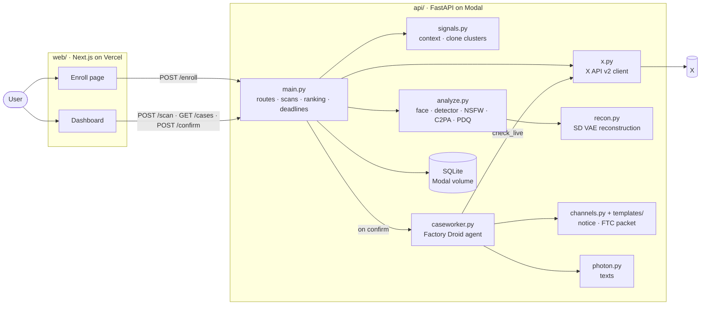

# Six Eyes

**Finds deepfakes of you on X, checks if they're fake and harmful, and drafts the TAKE IT DOWN notice when you say so.**

[Live site](https://six-eyes-henna.vercel.app) · [How it works in 30 seconds](https://six-eyes-henna.vercel.app/how-it-works.html) · [Detector results](ml/RESULTS.md) · [Devpost write-up](DEVPOST.md)

Since May 19, 2026, the TAKE IT DOWN Act (Pub. L. 119-12) gives a platform 48 hours to remove a reported
intimate image, real or AI-made. Two jobs still fall on the person in the picture: finding the posts, and
filing and following up on the notice. Six Eyes does both.

> Test mode is the default (`DRY_RUN=1`): nothing is ever submitted to a platform or the FTC. Six Eyes never
> stores media, and no language model ever sees an image.

**Contents:** [From selfie to takedown](#from-selfie-to-takedown) · [Architecture](#architecture) ·
[The codebase, mapped](#the-codebase-mapped) · [Every pitch claim, in the code](#every-pitch-claim-in-the-code) · [Is it them? Is it fake? Is it harmful?](#is-it-them-is-it-fake-is-it-harmful) ·
[How we built the detector](#how-we-built-the-detector) · [The case worker owns the deadline](#the-case-worker-owns-the-deadline) ·
[Guardrails](#guardrails) · [Run it](#run-it) · [Built with](#built-with)

## From selfie to takedown

| Step | What happens | Code |
|---|---|---|
| **1 · Enroll** | 3–5 selfies become one 512-number ArcFace face print. Each selfie must match the others (cosine ≥ 0.3), so one enrollment can't mix people. The photos are discarded. | [`web/app/enroll/`](web/app/enroll), `enroll()` in [`api/main.py`](api/main.py), [`api/face.py`](api/face.py) |
| **2 · Search X** | X can't search by image, so we search the words around it: the user's name and handles, the name plus 12 deepfake terms, and on request a sweep of the terms alone. Each query resumes after the newest post it has seen, so a rescan only pays for new posts. | [`api/x.py`](api/x.py), `run_scan()` in [`api/main.py`](api/main.py), [`api/data/keywords.json`](api/data/keywords.json) |
| **3 · Identify** | Every face in every image, and 16 evenly spaced frames of every video, is compared to the face print. Below 0.3 the post is dropped before the heavy models run. | [`api/face.py`](api/face.py), `FACE_MATCH_MIN` in [`api/main.py`](api/main.py) |
| **4 · Verify** | Three checks ask if it's fake (DINOv3 detector, reconstruction, C2PA). Three ask if it's harmful (intimate content, the post's context, copies). None decides alone. | [`api/analyze.py`](api/analyze.py), [`api/crops.py`](api/crops.py), [`api/recon.py`](api/recon.py), [`api/signals.py`](api/signals.py) |
| **5 · You decide** | Cases are ranked and shown blurred. "This is me" + "Not consensual" confirms the case and every copy of the same picture. | [`web/app/dashboard/cases.tsx`](web/app/dashboard/cases.tsx), `priority()` and `confirm()` in [`api/main.py`](api/main.py) |
| **6 · Take down** | A Factory Droid case worker drafts the TAKE IT DOWN notice and checks X again at 48 hours. If the post is still up, it prepares the FTC packet and texts the user. | [`api/caseworker.py`](api/caseworker.py), [`api/channels.py`](api/channels.py), [`api/templates/`](api/templates), [`api/photon.py`](api/photon.py) |

## Architecture



The web app only calls the API. The API holds one SQLite database on the Modal volume `six-eyes-db`: users
(name, handles, phone, face print), cases (post URL, scores, PDQ hash, clone cluster, state, deadline) and an
events timeline. A case moves `found` → `confirmed` → `noticed` → `resolved` or `escalated`.

## The codebase, mapped

### Search: finding posts on X

| File | What it does | Key names |
|---|---|---|
| [`api/x.py`](api/x.py) | X API v2 client: builds the queries, searches recent posts with their media and authors, and checks whether a post is still up. | `query()`, `keyword_query()`, `search()`, `sweep()`, `lookup()`, `is_live()`, `MAX_QUERY = 512` |
| [`api/main.py`](api/main.py) | Runs a scan: the three queries, face-matches every image, scores the matches, saves cases and re-clusters copies. | `scan()`, `run_scan()`, `background_scan()`, `recluster()`, `SWEEP_LIMIT = 100` |
| [`api/data/keywords.json`](api/data/keywords.json) | The 12 search terms, plus lists of flagged words, hashtags and link domains. | `search`, `keywords`, `hashtags`, `domains` |
| [`api/signals.py`](api/signals.py) | Context for each found post (flagged words, hashtags, links, account age, follower ratio, engagement) and clone clusters. | `signals()`, `clusters()`, `CLONE_MAX_DISTANCE = 31` |
| [`api/check_post.py`](api/check_post.py) | Debugging: why was a post found or missed? Reads one post and face-matches it. | `main()` |

### Model: is it them, is it fake

Runtime, called on every match during a scan:

| File | What it does | Key names |
|---|---|---|
| [`api/face.py`](api/face.py) | InsightFace `buffalo_l` (ArcFace): finds faces in an image or 16 video frames and compares them to the face print. | `match()`, `faces()`, `similarity()`, `VIDEO_FRAMES = 16` |
| [`api/analyze.py`](api/analyze.py) | The `analyze()` contract: one media URL in, every score out (face match, detector, NSFW, reconstruction, C2PA, PDQ). Skips the detector, NSFW and reconstruction when the face doesn't match. | `analyze()`, `detect()`, `probe()`, `nsfw()`, `c2pa()`, `pdq()`, `FAKE_THRESHOLD = 0.742` |
| [`api/crops.py`](api/crops.py) | The two 224 px views the detector sees: an aligned face crop and a center-square full image. | `face_crop()`, `full_view()` |
| [`api/recon.py`](api/recon.py) | AEROBLADE-style reconstruction: round-trips the image through Stable Diffusion 1.5's VAE and measures the LPIPS distance. | `score()`, `vae_roundtrip()` |

Training, run once on a GPU (outputs go to the git-ignored `data/`):

| File | What it does |
|---|---|
| [`ml/data.py`](ml/data.py) | Builds the 23,000-image training and validation set from DeepFakeFace, plus 3,000 aligned fakes made by passing real photos through the SD1.5, SDXL and FLUX VAEs. Writes `data/manifest.csv`. |
| [`ml/testset.py`](ml/testset.py) | Adds the team's consented photos and Grok Imagine edits. One teammate is held out as the test set. |
| [`ml/gen_testset.py`](ml/gen_testset.py) | Script for Grok Imagine edits through xAI's API. The 50 edits we used were made by hand in the Grok app instead. |
| [`ml/features.py`](ml/features.py) | Extracts frozen DINOv3 and CLIP features for both views of every image, once. |
| [`ml/heads.py`](ml/heads.py) | Logistic-regression probes on those features (UnivFD). Writes `data/models/dinov3_binary.joblib` and `dinov3_multi.joblib`, the heads the API ships. |
| [`ml/finetune.py`](ml/finetune.py) | LoRA fine-tune of DINOv3 (r = 16, last 8 blocks). It won validation but lost on the held-out teammate, so it doesn't ship. |
| [`ml/eval.py`](ml/eval.py) | One results table for every detector, and the threshold each would ship with (95% precision on validation). |
| [`ml/RESULTS.md`](ml/RESULTS.md) | Every number, and the decision that picked the shipped model. |

### Automated worker: the case worker and the 48-hour clock

| File | What it does | Key names |
|---|---|---|
| [`api/caseworker.py`](api/caseworker.py) | The Factory Droid agent. One session per confirmed case, five tools, rules enforced inside the tools. | `start()`, `work()`, `draft_notice`, `wait_until`, `check_live`, `escalate`, `notify_user`, `wake_due()` |
| [`api/main.py`](api/main.py) | The routes and logic the tools call: confirm a cluster, build the notice, recheck after the deadline, resolve or escalate. | `confirm()`, `notice()`, `work_case()`, `recheck()`, `resolve()`, `escalate()`, `ftc_packet()`, `timewarp()` |
| [`api/channels.py`](api/channels.py) | Each platform's takedown channel, the validated TAKE IT DOWN notice, X's form answers, and test-mode email. | `TakedownNotice`, `render()`, `form_answers()`, `send_email()` |
| [`api/templates/`](api/templates) | `notice.md` (the full notice), `details.md` (X's free-text field), `ftc_packet.md` (the escalation), `NOTES.md` (how they map). | |
| [`api/data/channels.json`](api/data/channels.json) | Takedown channels: X's form first, then Instagram, Facebook, TikTok, Reddit, Snapchat, Bluesky and StopNCII, plus the FTC and minors escalation routes. | |
| [`api/photon.py`](api/photon.py) | Texts the user through Photon (iMessage or SMS) when a case is filed, resolved or escalated. | `send()`, `enabled()` |
| [`api/modal_app.py`](api/modal_app.py) | `deadline_sweep` calls `POST /recheck` every hour, to wake the case worker if the container scaled down. | `deadline_sweep()` |

### Product: the web app

| File | What it does |
|---|---|
| [`web/app/page.tsx`](web/app/page.tsx) | Landing page, with links to enrollment and the 30-second walkthrough. |
| [`web/app/enroll/`](web/app/enroll) | `enroll-form.tsx`: name, handles, phone, 3–5 selfies, consent and e-signature. Calls `POST /enroll`, then starts the first scan. |
| [`web/app/dashboard/`](web/app/dashboard) | `cases.tsx`: ranked, blurred case cards with the evidence, "This is me" + "Not consensual", the notice packet, and the test-only time warp. |
| [`web/content/consent.md`](web/content/consent.md) | The authorization, biometric consent and retention text shown at enrollment. |
| [`web/public/how-it-works.html`](web/public/how-it-works.html) | The 30-second animated walkthrough of the system. |

### Infrastructure, tests and notes

| File | What it does |
|---|---|
| [`api/modal_app.py`](api/modal_app.py) | The Modal image (model weights baked in), the secrets `six-eyes-x`, `huggingface` and `factory`, the `six-eyes-db` volume, and the web endpoint. |
| [`api/test_*.py`](api) | Self-checks for enroll, face matching, scans, the case worker and Photon. X, Droid and the network are faked, so no keys are needed. |
| [`.env.example`](.env.example) | Every setting, with `DRY_RUN=1` and a 5-second demo deadline. |
| [`deepfake-detection-research-context.md`](deepfake-detection-research-context.md) | The literature review (~120 papers) behind the model choices. |
| [`HANDOFF_C_to_A.md`](HANDOFF_C_to_A.md), [`DEVPOST.md`](DEVPOST.md) | The team test-data handoff and the Devpost write-up. |

## Every pitch claim, in the code

Each number and feature on the live pitch and the pitch page, in slide order (the same six steps as the [30-second walkthrough](https://six-eyes-henna.vercel.app/how-it-works.html)), linked to the lines behind it. Links are pinned to commit [`2396f91`](https://github.com/snowf1akes/six-eyes/blob/2396f914e88fa861e46dc31924dcb39ecb22b419), so the line numbers stay exact.

### Title

| Claim | What the code does | Where |
|---|---|---|
| 48 hours to remove a reported intimate image | The deadline every notice is due by, and the Act's wording in the notice and the FTC packet. | [`api/main.py:65-68`](https://github.com/snowf1akes/six-eyes/blob/2396f914e88fa861e46dc31924dcb39ecb22b419/api/main.py#L65-L68)<br>[`api/templates/notice.md:7`](https://github.com/snowf1akes/six-eyes/blob/2396f914e88fa861e46dc31924dcb39ecb22b419/api/templates/notice.md#L7)<br>[`api/templates/ftc_packet.md:19`](https://github.com/snowf1akes/six-eyes/blob/2396f914e88fa861e46dc31924dcb39ecb22b419/api/templates/ftc_packet.md#L19) |

### 1 · Enroll

| Claim | What the code does | Where |
|---|---|---|
| 3–5 selfies | Enrollment rejects fewer than 3 or more than 5. | [`api/main.py:189`](https://github.com/snowf1akes/six-eyes/blob/2396f914e88fa861e46dc31924dcb39ecb22b419/api/main.py#L189) |
| A 512-number face print | Each selfie becomes an ArcFace vector; the user's print is their normalized mean, stored as 512 floats. | [`api/main.py:156`](https://github.com/snowf1akes/six-eyes/blob/2396f914e88fa861e46dc31924dcb39ecb22b419/api/main.py#L156)<br>[`api/main.py:208-209`](https://github.com/snowf1akes/six-eyes/blob/2396f914e88fa861e46dc31924dcb39ecb22b419/api/main.py#L208-L209)<br>[`api/main.py:95`](https://github.com/snowf1akes/six-eyes/blob/2396f914e88fa861e46dc31924dcb39ecb22b419/api/main.py#L95) |
| Each selfie has to match the others (≥ 0.3) | Leave-one-out check: each selfie against the mean of the rest. | [`api/main.py:59`](https://github.com/snowf1akes/six-eyes/blob/2396f914e88fa861e46dc31924dcb39ecb22b419/api/main.py#L59)<br>[`api/main.py:204-205`](https://github.com/snowf1akes/six-eyes/blob/2396f914e88fa861e46dc31924dcb39ecb22b419/api/main.py#L204-L205) |
| The photos are deleted · 0 photos kept | Uploads are read into memory and closed; only the vector is inserted. | [`api/main.py:196`](https://github.com/snowf1akes/six-eyes/blob/2396f914e88fa861e46dc31924dcb39ecb22b419/api/main.py#L196)<br>[`api/main.py:214`](https://github.com/snowf1akes/six-eyes/blob/2396f914e88fa861e46dc31924dcb39ecb22b419/api/main.py#L214) |

### 2 · Search X

| Claim | What the code does | Where |
|---|---|---|
| X can't search by image, so we search the words around it | The name, handles and replies-to query, images and videos only, no reposts. | [`api/x.py:55`](https://github.com/snowf1akes/six-eyes/blob/2396f914e88fa861e46dc31924dcb39ecb22b419/api/x.py#L55)<br>[`api/x.py:16`](https://github.com/snowf1akes/six-eyes/blob/2396f914e88fa861e46dc31924dcb39ecb22b419/api/x.py#L16) |
| Plus 12 deepfake terms | The search terms and the query that pairs them with the name. | [`api/data/keywords.json:3-16`](https://github.com/snowf1akes/six-eyes/blob/2396f914e88fa861e46dc31924dcb39ecb22b419/api/data/keywords.json#L3-L16)<br>[`api/x.py:60`](https://github.com/snowf1akes/six-eyes/blob/2396f914e88fa861e46dc31924dcb39ecb22b419/api/x.py#L60) |
| 3 queries | Name + terms, then the name alone, then (when asked) a sweep of the terms alone. | [`api/main.py:286-290`](https://github.com/snowf1akes/six-eyes/blob/2396f914e88fa861e46dc31924dcb39ecb22b419/api/main.py#L286-L290)<br>[`api/x.py:75`](https://github.com/snowf1akes/six-eyes/blob/2396f914e88fa861e46dc31924dcb39ecb22b419/api/x.py#L75) |
| The sweep on enrollment | Enrolling starts the first scan with the sweep on. | [`web/app/enroll/enroll-form.tsx:73`](https://github.com/snowf1akes/six-eyes/blob/2396f914e88fa861e46dc31924dcb39ecb22b419/web/app/enroll/enroll-form.tsx#L73) |
| Only new posts · $0.005 a post | Each query resumes after the newest post it found, because X bills every post read. The price is X's, not in our code. | [`api/main.py:273-282`](https://github.com/snowf1akes/six-eyes/blob/2396f914e88fa861e46dc31924dcb39ecb22b419/api/main.py#L273-L282)<br>[`api/main.py:61`](https://github.com/snowf1akes/six-eyes/blob/2396f914e88fa861e46dc31924dcb39ecb22b419/api/main.py#L61) |

### 3 · Identify

| Claim | What the code does | Where |
|---|---|---|
| ArcFace compares every face to the face print | Cosine similarity, best face in the image. | [`api/face.py:42`](https://github.com/snowf1akes/six-eyes/blob/2396f914e88fa861e46dc31924dcb39ecb22b419/api/face.py#L42)<br>[`api/face.py:64`](https://github.com/snowf1akes/six-eyes/blob/2396f914e88fa861e46dc31924dcb39ecb22b419/api/face.py#L64) |
| 0.986 you · 0.079 a stranger | Printed by the face self-check on InsightFace's bundled group photo. | [`api/test_face.py:63`](https://github.com/snowf1akes/six-eyes/blob/2396f914e88fa861e46dc31924dcb39ecb22b419/api/test_face.py#L63) |
| Below 0.3 we drop it | The case cutoff, and the gate that skips the detector, NSFW and reconstruction on non-matches. | [`api/main.py:60`](https://github.com/snowf1akes/six-eyes/blob/2396f914e88fa861e46dc31924dcb39ecb22b419/api/main.py#L60)<br>[`api/analyze.py:30`](https://github.com/snowf1akes/six-eyes/blob/2396f914e88fa861e46dc31924dcb39ecb22b419/api/analyze.py#L30)<br>[`api/analyze.py:51`](https://github.com/snowf1akes/six-eyes/blob/2396f914e88fa861e46dc31924dcb39ecb22b419/api/analyze.py#L51) |
| 16 frames per video | Evenly spaced frames; the video scores the best frame. | [`api/face.py:16`](https://github.com/snowf1akes/six-eyes/blob/2396f914e88fa861e46dc31924dcb39ecb22b419/api/face.py#L16)<br>[`api/face.py:88`](https://github.com/snowf1akes/six-eyes/blob/2396f914e88fa861e46dc31924dcb39ecb22b419/api/face.py#L88) |

### 4 · Verify: is it fake?

| Claim | What the code does | Where |
|---|---|---|
| DINOv3 detector, face + whole image | Two 224 px views, DINOv3 ViT-L features, one logistic-regression row per face. | [`api/analyze.py:25`](https://github.com/snowf1akes/six-eyes/blob/2396f914e88fa861e46dc31924dcb39ecb22b419/api/analyze.py#L25)<br>[`api/crops.py:18`](https://github.com/snowf1akes/six-eyes/blob/2396f914e88fa861e46dc31924dcb39ecb22b419/api/crops.py#L18)<br>[`api/crops.py:30`](https://github.com/snowf1akes/six-eyes/blob/2396f914e88fa861e46dc31924dcb39ecb22b419/api/crops.py#L30)<br>[`api/analyze.py:98`](https://github.com/snowf1akes/six-eyes/blob/2396f914e88fa861e46dc31924dcb39ecb22b419/api/analyze.py#L98)<br>[`ml/heads.py:51`](https://github.com/snowf1akes/six-eyes/blob/2396f914e88fa861e46dc31924dcb39ecb22b419/ml/heads.py#L51) |
| Cutoff 0.742 · 95% precision | The shipped threshold, and where it is picked on validation. | [`api/analyze.py:27`](https://github.com/snowf1akes/six-eyes/blob/2396f914e88fa861e46dc31924dcb39ecb22b419/api/analyze.py#L27)<br>[`ml/eval.py:87`](https://github.com/snowf1akes/six-eyes/blob/2396f914e88fa861e46dc31924dcb39ecb22b419/ml/eval.py#L87) |
| Reconstruction through Stable Diffusion's autoencoder | SD1.5 VAE round trip, LPIPS distance. | [`api/recon.py:23`](https://github.com/snowf1akes/six-eyes/blob/2396f914e88fa861e46dc31924dcb39ecb22b419/api/recon.py#L23)<br>[`api/recon.py:47`](https://github.com/snowf1akes/six-eyes/blob/2396f914e88fa861e46dc31924dcb39ecb22b419/api/recon.py#L47) |
| C2PA labels | Valid, broken, or no Content Credentials in the file. | [`api/analyze.py:64`](https://github.com/snowf1akes/six-eyes/blob/2396f914e88fa861e46dc31924dcb39ecb22b419/api/analyze.py#L64) |

### 4 · Verify: is it harmful?

| Claim | What the code does | Where |
|---|---|---|
| Intimate content (NSFW ≥ 0.5) | The NSFW model, and the gate a live notice must pass. | [`api/analyze.py:26`](https://github.com/snowf1akes/six-eyes/blob/2396f914e88fa861e46dc31924dcb39ecb22b419/api/analyze.py#L26)<br>[`api/main.py:81`](https://github.com/snowf1akes/six-eyes/blob/2396f914e88fa861e46dc31924dcb39ecb22b419/api/main.py#L81)<br>[`api/main.py:473`](https://github.com/snowf1akes/six-eyes/blob/2396f914e88fa861e46dc31924dcb39ecb22b419/api/main.py#L473) |
| The post's context: hashtags, sales links, burner accounts | Flagged words, hashtags and domains; account age and follower ratio; engagement. | [`api/signals.py:53`](https://github.com/snowf1akes/six-eyes/blob/2396f914e88fa861e46dc31924dcb39ecb22b419/api/signals.py#L53)<br>[`api/main.py:360`](https://github.com/snowf1akes/six-eyes/blob/2396f914e88fa861e46dc31924dcb39ecb22b419/api/main.py#L360)<br>[`api/main.py:361`](https://github.com/snowf1akes/six-eyes/blob/2396f914e88fa861e46dc31924dcb39ecb22b419/api/main.py#L361) |
| Copies: PDQ, 31 of 256 bits | The perceptual hash, the match distance, and the union-find clusters. | [`api/analyze.py:145`](https://github.com/snowf1akes/six-eyes/blob/2396f914e88fa861e46dc31924dcb39ecb22b419/api/analyze.py#L145)<br>[`api/signals.py:18`](https://github.com/snowf1akes/six-eyes/blob/2396f914e88fa861e46dc31924dcb39ecb22b419/api/signals.py#L18)<br>[`api/signals.py:66`](https://github.com/snowf1akes/six-eyes/blob/2396f914e88fa861e46dc31924dcb39ecb22b419/api/signals.py#L66)<br>[`api/signals.py:83`](https://github.com/snowf1akes/six-eyes/blob/2396f914e88fa861e46dc31924dcb39ecb22b419/api/signals.py#L83) |
| A repost is 8 bits apart, a different photo 136 | Printed by the face self-check. | [`api/test_face.py:72`](https://github.com/snowf1akes/six-eyes/blob/2396f914e88fa861e46dc31924dcb39ecb22b419/api/test_face.py#L72) |
| None decides alone | The ranking that orders the dashboard: identity × (0.4 flagged + 0.3 fake + 0.15 NSFW + 0.15 spread). | [`api/main.py:63`](https://github.com/snowf1akes/six-eyes/blob/2396f914e88fa861e46dc31924dcb39ecb22b419/api/main.py#L63)<br>[`api/main.py:352-364`](https://github.com/snowf1akes/six-eyes/blob/2396f914e88fa861e46dc31924dcb39ecb22b419/api/main.py#L352-L364) |

### 5 · You decide

| Claim | What the code does | Where |
|---|---|---|
| Matches stay blurred until you choose to look | Every card's media starts blurred. | [`web/app/dashboard/cases.tsx:1012`](https://github.com/snowf1akes/six-eyes/blob/2396f914e88fa861e46dc31924dcb39ecb22b419/web/app/dashboard/cases.tsx#L1012)<br>[`web/app/dashboard/page.tsx:14`](https://github.com/snowf1akes/six-eyes/blob/2396f914e88fa861e46dc31924dcb39ecb22b419/web/app/dashboard/page.tsx#L14) |
| Nothing is filed until you confirm | Only confirmed cases get a notice. | [`api/main.py:404`](https://github.com/snowf1akes/six-eyes/blob/2396f914e88fa861e46dc31924dcb39ecb22b419/api/main.py#L404)<br>[`api/main.py:460`](https://github.com/snowf1akes/six-eyes/blob/2396f914e88fa861e46dc31924dcb39ecb22b419/api/main.py#L460) |
| 1 confirm covers every copy | Confirming one case confirms its whole clone cluster. | [`api/main.py:414-416`](https://github.com/snowf1akes/six-eyes/blob/2396f914e88fa861e46dc31924dcb39ecb22b419/api/main.py#L414-L416) |

### 6 · Take down

| Claim | What the code does | Where |
|---|---|---|
| A case worker (Factory Droid) drafts the TAKE IT DOWN notice | The agent's tool, the notice logic, and the validated notice. | [`api/caseworker.py:226`](https://github.com/snowf1akes/six-eyes/blob/2396f914e88fa861e46dc31924dcb39ecb22b419/api/caseworker.py#L226)<br>[`api/main.py:446`](https://github.com/snowf1akes/six-eyes/blob/2396f914e88fa861e46dc31924dcb39ecb22b419/api/main.py#L446)<br>[`api/channels.py:57`](https://github.com/snowf1akes/six-eyes/blob/2396f914e88fa861e46dc31924dcb39ecb22b419/api/channels.py#L57)<br>[`api/templates/notice.md:7`](https://github.com/snowf1akes/six-eyes/blob/2396f914e88fa861e46dc31924dcb39ecb22b419/api/templates/notice.md#L7) |
| Checks X again at 48 hours | The agent waits for the deadline, then checks every post; Modal wakes it hourly if needed. | [`api/caseworker.py:243`](https://github.com/snowf1akes/six-eyes/blob/2396f914e88fa861e46dc31924dcb39ecb22b419/api/caseworker.py#L243)<br>[`api/caseworker.py:270`](https://github.com/snowf1akes/six-eyes/blob/2396f914e88fa861e46dc31924dcb39ecb22b419/api/caseworker.py#L270)<br>[`api/main.py:543`](https://github.com/snowf1akes/six-eyes/blob/2396f914e88fa861e46dc31924dcb39ecb22b419/api/main.py#L543)<br>[`api/modal_app.py:81-82`](https://github.com/snowf1akes/six-eyes/blob/2396f914e88fa861e46dc31924dcb39ecb22b419/api/modal_app.py#L81-L82) |
| If it's still up, it prepares the FTC report | Escalation and the packet a person submits at TakeItDown.ftc.gov. | [`api/caseworker.py:292`](https://github.com/snowf1akes/six-eyes/blob/2396f914e88fa861e46dc31924dcb39ecb22b419/api/caseworker.py#L292)<br>[`api/main.py:595`](https://github.com/snowf1akes/six-eyes/blob/2396f914e88fa861e46dc31924dcb39ecb22b419/api/main.py#L595)<br>[`api/main.py:626`](https://github.com/snowf1akes/six-eyes/blob/2396f914e88fa861e46dc31924dcb39ecb22b419/api/main.py#L626)<br>[`api/templates/ftc_packet.md:19`](https://github.com/snowf1akes/six-eyes/blob/2396f914e88fa861e46dc31924dcb39ecb22b419/api/templates/ftc_packet.md#L19) |
| And texts you (Photon) | Every state change is texted if the user enrolled a phone. | [`api/caseworker.py:310`](https://github.com/snowf1akes/six-eyes/blob/2396f914e88fa861e46dc31924dcb39ecb22b419/api/caseworker.py#L310)<br>[`api/main.py:788`](https://github.com/snowf1akes/six-eyes/blob/2396f914e88fa861e46dc31924dcb39ecb22b419/api/main.py#L788)<br>[`api/photon.py:43`](https://github.com/snowf1akes/six-eyes/blob/2396f914e88fa861e46dc31924dcb39ecb22b419/api/photon.py#L43) |
| Test mode | Only an explicit DRY_RUN=0 goes live; time-warp only works in test mode. | [`api/main.py:441`](https://github.com/snowf1akes/six-eyes/blob/2396f914e88fa861e46dc31924dcb39ecb22b419/api/main.py#L441)<br>[`api/main.py:748`](https://github.com/snowf1akes/six-eyes/blob/2396f914e88fa861e46dc31924dcb39ecb22b419/api/main.py#L748) |
| The agent can't go rogue | At most 2 messages of 800 characters; Droid's own tools are off. | [`api/caseworker.py:51-52`](https://github.com/snowf1akes/six-eyes/blob/2396f914e88fa861e46dc31924dcb39ecb22b419/api/caseworker.py#L51-L52)<br>[`api/caseworker.py:147`](https://github.com/snowf1akes/six-eyes/blob/2396f914e88fa861e46dc31924dcb39ecb22b419/api/caseworker.py#L147) |

### The work behind the detector

| Claim | What the code does | Where |
|---|---|---|
| 23,000 training and validation images | DeepFakeFace plus our aligned fakes, split 85/15 by source photo. | [`ml/RESULTS.md:11-12`](https://github.com/snowf1akes/six-eyes/blob/2396f914e88fa861e46dc31924dcb39ecb22b419/ml/RESULTS.md#L11-L12)<br>[`ml/data.py:31`](https://github.com/snowf1akes/six-eyes/blob/2396f914e88fa861e46dc31924dcb39ecb22b419/ml/data.py#L31) |
| 3,000 fakes through 3 autoencoders | Real photos encoded and decoded by the SD1.5, SDXL or FLUX VAE. | [`ml/data.py:32`](https://github.com/snowf1akes/six-eyes/blob/2396f914e88fa861e46dc31924dcb39ecb22b419/ml/data.py#L32)<br>[`ml/data.py:100`](https://github.com/snowf1akes/six-eyes/blob/2396f914e88fa861e46dc31924dcb39ecb22b419/ml/data.py#L100) |
| 100 + 50 team photos and Grok edits; one teammate held out | Who is held out, and how the team set joins the manifest. | [`ml/RESULTS.md:13`](https://github.com/snowf1akes/six-eyes/blob/2396f914e88fa861e46dc31924dcb39ecb22b419/ml/RESULTS.md#L13)<br>[`ml/RESULTS.md:43`](https://github.com/snowf1akes/six-eyes/blob/2396f914e88fa861e46dc31924dcb39ecb22b419/ml/RESULTS.md#L43)<br>[`ml/testset.py:26`](https://github.com/snowf1akes/six-eyes/blob/2396f914e88fa861e46dc31924dcb39ecb22b419/ml/testset.py#L26) |
| 5 detectors benchmarked on a teammate they never saw | One table, one threshold each. | [`ml/RESULTS.md:76-80`](https://github.com/snowf1akes/six-eyes/blob/2396f914e88fa861e46dc31924dcb39ecb22b419/ml/RESULTS.md#L76-L80)<br>[`ml/eval.py:104`](https://github.com/snowf1akes/six-eyes/blob/2396f914e88fa861e46dc31924dcb39ecb22b419/ml/eval.py#L104) |
| ~120 papers reviewed | The research handoff. | [`deepfake-detection-research-context.md:13`](https://github.com/snowf1akes/six-eyes/blob/2396f914e88fa861e46dc31924dcb39ecb22b419/deepfake-detection-research-context.md#L13) |
| 0 of 49 real photos falsely flagged | The shipped probe at its threshold, on the held-out teammate. | [`ml/RESULTS.md:78`](https://github.com/snowf1akes/six-eyes/blob/2396f914e88fa861e46dc31924dcb39ecb22b419/ml/RESULTS.md#L78)<br>[`ml/RESULTS.md:86`](https://github.com/snowf1akes/six-eyes/blob/2396f914e88fa861e46dc31924dcb39ecb22b419/ml/RESULTS.md#L86) |

### Model choice

| Claim | What the code does | Where |
|---|---|---|
| LoRA validation AUC 0.909 → 0.926 → 0.928 vs the probe's 0.887 | Per-epoch validation AUC of the fine-tune. | [`ml/RESULTS.md:98`](https://github.com/snowf1akes/six-eyes/blob/2396f914e88fa861e46dc31924dcb39ecb22b419/ml/RESULTS.md#L98) |
| Grok AUC 0.662 · 0.686 (ships) · 0.695 · 0.514 | The held-out teammate's Grok edits, with and without Grok in training. | [`ml/RESULTS.md:52-55`](https://github.com/snowf1akes/six-eyes/blob/2396f914e88fa861e46dc31924dcb39ecb22b419/ml/RESULTS.md#L52-L55) |
| LoRA + Grok flagged 92% of real photos | It learned the teammate's phone photos, not Grok. | [`ml/RESULTS.md:64`](https://github.com/snowf1akes/six-eyes/blob/2396f914e88fa861e46dc31924dcb39ecb22b419/ml/RESULTS.md#L64) |
| 2.36M-weight LoRA vs 2,049-weight probe | r = 16 on q, k, v, o and the MLP of DINOv3's last 8 blocks (2,359,296 weights); the probe is one weight per feature of the 2 × 1024 views, plus a bias. | [`ml/finetune.py:32`](https://github.com/snowf1akes/six-eyes/blob/2396f914e88fa861e46dc31924dcb39ecb22b419/ml/finetune.py#L32)<br>[`ml/finetune.py:110`](https://github.com/snowf1akes/six-eyes/blob/2396f914e88fa861e46dc31924dcb39ecb22b419/ml/finetune.py#L110)<br>[`ml/heads.py:51`](https://github.com/snowf1akes/six-eyes/blob/2396f914e88fa861e46dc31924dcb39ecb22b419/ml/heads.py#L51) |
| The probe ships | The rule LoRA had to beat, and the decision. | [`ml/RESULTS.md:82`](https://github.com/snowf1akes/six-eyes/blob/2396f914e88fa861e46dc31924dcb39ecb22b419/ml/RESULTS.md#L82) |

## Is it them? Is it fake? Is it harmful?

| Question | Check | How | Code | Cutoff |
|---|---|---|---|---|
| Is it them? | Face match | Cosine between ArcFace embeddings and the face print; for video, the best of 16 frames. | `face.match()` | 0.3 |
| Is it fake? | DINOv3 detector | Frozen DINOv3 ViT-L/16 features of the aligned face and the full image, joined into one logistic regression. The face view catches swaps; the full view catches edited bodies and backgrounds. | `analyze.detect()`, `crops.py`, `ml/heads.py` | 0.742, the lowest with 95% precision on validation |
| Is it fake? | Reconstruction | Stable Diffusion images come back almost unchanged through SD's own autoencoder; camera photos don't. | `recon.score()` | Evidence only |
| Is it fake? | C2PA | Reads signed Content Credentials in the file: valid, broken, or none. X can strip them, so absence proves nothing. | `analyze.c2pa()` | Proof when present |
| Is it harmful? | Intimate | NSFW classifier (Falconsai). The Act covers intimate images. | `analyze.nsfw()`, `INTIMATE_MIN` | 0.5 for a live notice |
| Is it harmful? | Context | Flagged words, hashtags and link domains in the post; a burner author (under 30 days old, or follower ratio under 0.1); engagement. Replies are counted, not read. | `signals.signals()` | Ranking only |
| Is it harmful? | Copies | 256-bit PDQ perceptual hash. Two images 31 bits apart or fewer are the same picture; one confirmation covers the whole cluster. | `analyze.pdq()`, `signals.clusters()` | 31 of 256 bits |

The dashboard's order comes from `priority()` in [`api/main.py`](api/main.py):
`identity × (0.4 · flagged + 0.3 · fake + 0.15 · nsfw + 0.15 · spread)`, where identity scales the face match
from 0.2 to 0.6 and spread combines reach, copies, burner accounts and flagged links.

## How we built the detector

**Data**

- **Training and validation, 23,000 images:** DeepFakeFace's 10,000 real faces and 10,000 fakes (3,334
  text-to-image, 3,333 inpainting, 3,333 face swap), plus 3,000 fakes we made by passing real photos through
  the SD1.5, SDXL and FLUX autoencoders. These aligned fakes differ from their source only in the decoder's
  trace, so the model can't cheat on content or format. Split 85/15 by source photo: 19,515 / 3,485.
- **Team set, 148 usable images:** 100 consented phone photos of two teammates and 50 hand-made Grok Imagine
  edits. One teammate's 49 photos and 24 edits are held out and never trained on; the other's join training.

**Results** (from [`ml/RESULTS.md`](ml/RESULTS.md); held out = the teammate no model trained on)

| Model | Val AUC | Held-out Grok AUC | Threshold | Held-out real photos flagged |
|---|---:|---:|---:|---:|
| CLIP probe | 0.903 | 0.429 | 0.698 | 20% |
| DINOv3 probe | 0.887 | 0.662 | 0.746 | 0% |
| **DINOv3 probe + Grok (ships)** | 0.887 | **0.686** | **0.742** | **0%** (0 of 49) |
| DINOv3 + LoRA, with Grok | **0.929** | 0.514 | 0.764 | 92% |
| Reconstruction (SD1.5 VAE) | 0.796 | 0.228 | 0.078 | 39% |

**We shipped the model that generalized.** The 2.36-million-weight LoRA won validation, but given 25 Grok images
it learned "a teammate's phone photo" and flagged 92% of the held-out teammate's real photos. The 2,049-weight
probe flagged none, so it ships. It is precise and still misses most Grok edits (1 of 24), which is why it is
one line of evidence and the user's confirmation decides.

Reproduce from the repo root: `python ml/data.py`, `ml/testset.py`, `ml/features.py`, `ml/heads.py`,
`ml/finetune.py`, then `ml/eval.py`.

## The case worker owns the deadline

Finding a deepfake is half the job; the other half is following it until it's gone. The case worker
is a [Factory Droid](https://docs.factory.ai/sdk/python) agent that takes each confirmed case from
"the user says this is them, shared without consent" to either "removed" or "escalated", and keeps
the user told along the way. It lives in [`api/caseworker.py`](api/caseworker.py).

### When it runs

| Trigger | Where | What the agent is asked to do |
| --- | --- | --- |
| The user confirms a case ("This is me" + "Not consensual") | `POST /cases/{id}/confirm` | Make the reports, tell the user, then `wait_until` the deadline and close the case |
| The deadline timer fires, or a missed wake (dashboard / `/recheck` / time-warp) | `wait_until` or `wake_due` | Check X, resolve or escalate, tell the user |
| The team asks for a check | `POST /cases/{id}/work` | Check now, even before the deadline (never escalates early) |

Each run is one fresh Droid session (`droid_sdk.Session`) in a background thread, briefed with the
case's posts, states and deadline. A cluster has at most one session at a time. If the case worker
is off, `recheck` still texts the user itself.

### Its five tools

The tools are Python functions served to Droid over an in-process MCP server
(`droid_sdk.mcp.create_sdk_mcp_server`). They call code Six Eyes already has:

| Tool | Calls | Effect |
| --- | --- | --- |
| `draft_notice(case_id)` | `main.notice()`, the `POST /cases/{id}/notice` logic | TAKE IT DOWN reports for every post in the clone cluster, one per posting account; the cluster moves to `noticed`, due in 48 hours. Safe to repeat. |
| `wait_until(case_id)` | in-process sleep or `threading.Timer` | Sleeps when `due_at` is soon; otherwise schedules a deadline session. Time-warp cuts it short. |
| `check_live(case_id)` | `main.post_status` (`x.is_live`) on every noticed post | Posts that are gone move to `resolved`. |
| `escalate(case_id)` | `main.escalate` | Posts still up after the deadline move to `escalated`, with an FTC complaint packet for TakeItDown.ftc.gov. |
| `notify_user(user_id, text)` | Photon SMS via `main.tell_user` | A short text if they enrolled a number. |

### What the agent decides, and what it can't

The agent chooses which tools to call and writes every message to the user: plain, calm, two or three
sentences, never describing the images, never promising an outcome. The rules live in the tools, so
a wrong turn by the model fails as a tool error it can recover from instead of doing harm:

- It can only act on the case it was started for, and only message that case's user.
- `check_live` makes at most one billed X call per post per session, and only after the deadline
  (unless the team asked).
- `escalate` needs a `check_live` in the same session that saw the post still up, and a passed deadline.
- At most two messages per session, each under 800 characters.
- Droid's built-in tools are refused: `Autonomy.OFF` sends every action to a permission handler that
  approves only these five tools, the session runs in an empty temporary folder, and built-in skills
  are off.
- Nothing is ever submitted to a platform. X only takes a web form that a person fills in; in test
  mode (`DRY_RUN=1`, the default) messages start with "Test:" and escalations aren't filed.

Every session is logged as a `caseworker` event on the case: why it ran, the Droid session id, each
tool call, and the agent's closing summary. Tool effects are logged too (`resolved`, `escalated`).

### After the 48 hours

The TAKE IT DOWN Act gives a platform 48 hours to remove a reported intimate depiction and its
identical copies. The **Factory case worker** owns that clock. After it drafts the notice it calls
`wait_until`: if the deadline is soon (a local demo with `NOTICE_DEADLINE_SECONDS=5`) it sleeps
inside the same Droid session, then checks X. If the deadline is farther away it arms an in-process
timer that starts a fresh session at `due_at`.

Modal still stops the API container after 10 idle minutes, which would kill that timer. Opening the
dashboard (`GET /cases/{user_id}`) or `POST /recheck` (Modal's hourly `deadline_sweep`) only **wakes
overdue Factory sessions** if the timer died. If the case worker is off, those paths settle the
cluster themselves:

- each post in the cluster is checked on X (`x.is_live`)
- posts that are gone become **resolved**
- posts still up become **escalated**, with an FTC complaint packet stored on the case

`POST /timewarp/{case_id}` is test-mode only: it sets `due_at` to now and cuts the Factory wait
short, so a demo doesn't wait two days. The dashboard's "Skip the 48-hour wait (test)" button
calls it.

Nothing is filed with the FTC automatically. `escalate` fills
[`api/templates/ftc_packet.md`](api/templates/ftc_packet.md) with the still-up URLs, PDQ hashes, the
cluster's timeline, the evidence scores and the notice copy, plus the
[TakeItDown.ftc.gov](https://takeitdown.ftc.gov) link, and stores that packet in an `escalated`
event. A person submits it. The user is **texted** through Photon (`api/photon.py`) if they enrolled
a phone number: X missed the 48 hours, escalate at TakeItDown.ftc.gov, the team has the packet.

### Running the case worker

1. Install the droid CLI (`curl -fsSL https://app.factory.ai/cli | sh`) and the API's requirements,
   which include `droid-sdk[mcp]`.
2. Set `FACTORY_API_KEY` (or log in with `droid`). `CASEWORKER=0` turns the agent off;
   `CASEWORKER_MODEL` picks the model (default `auto`, Factory's router).
3. For a demo, confirm a case. With `NOTICE_DEADLINE_SECONDS=5` Factory waits in the same session.
   **Skip the 48-hour wait (test)** on the dashboard (or `POST /timewarp/{case_id}`) cuts the wait
   short, checks X, and prepares the FTC packet.

On Modal, the image installs the CLI, the `factory` secret holds `FACTORY_API_KEY`, and
`deadline_sweep` hits `POST /recheck` hourly to wake sessions if the container scaled down.
`api/test_caseworker.py` and the time-warp block in `api/test_scan.py` check this with a scripted
stand-in for Droid and X, so they need no key.

## Guardrails

- **Test mode by default.** Only `DRY_RUN=0` goes live, and even then a person submits X's web form and the
  FTC complaint.
- **No media is stored.** Selfies are discarded once the face print is made. Found media is analyzed in
  memory; we keep post URLs, hashes and scores.
- **Language models never see images.** The case worker gets text only: post URLs, states and the deadline.
- **The person decides.** Only "This is me" + "Not consensual" starts a notice, and a live notice needs an
  NSFW score of at least 0.5, the Act's scope.
- **Consented test data only.** The team photographed themselves; no celebrities, no real victims.

## Run it

The API, from the repo root (`api/` is the import root):

```bash
python -m venv .venv
.venv/Scripts/pip install -r api/requirements.txt
cp .env.example .env
.venv/Scripts/uvicorn main:app --app-dir api --reload --port 8000
```

The web app (it calls `NEXT_PUBLIC_API_URL`, default `http://localhost:8000`):

```bash
cd web && npm install && npm run dev
```

Self-checks, from the repo root: `.venv/Scripts/python api/test_scan.py` (also `test_enroll.py`,
`test_face.py`, `test_caseworker.py`, `test_photon.py`).

Deploy: `.venv/Scripts/modal deploy api/modal_app.py` from a machine that has the trained heads in
`data/models/`. Vercel builds `web/` on every push to `main`.

## Built with

**Web:** Next.js, React, TypeScript, Vercel ·
**Backend:** Python, FastAPI, SQLite, Modal, X API v2 ·
**Models:** PyTorch, Hugging Face Transformers, DINOv3, InsightFace (ArcFace), scikit-learn, PEFT (LoRA),
Diffusers, LPIPS, c2pa-python, PDQ ·
**Sponsors:** Factory Droid, Photon, Grok Imagine
